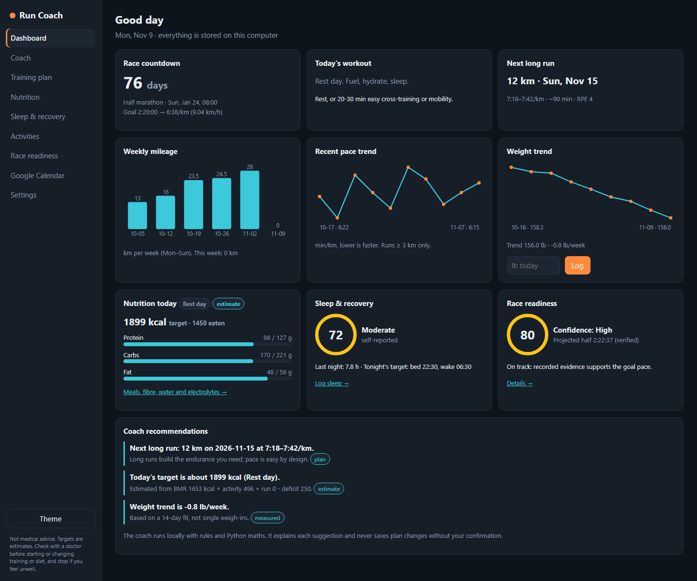
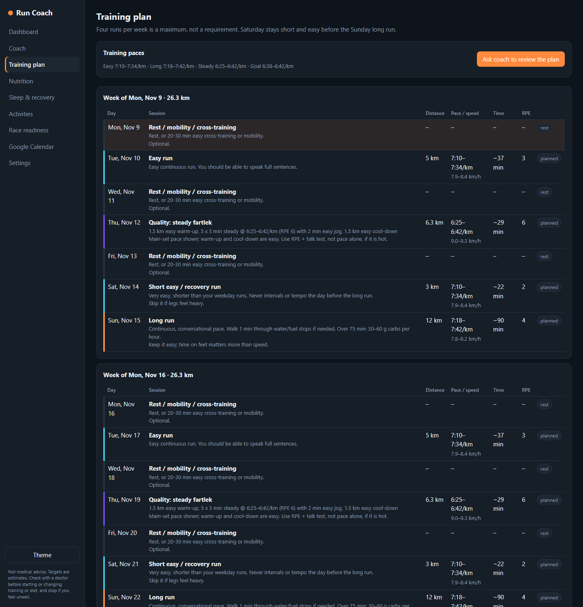
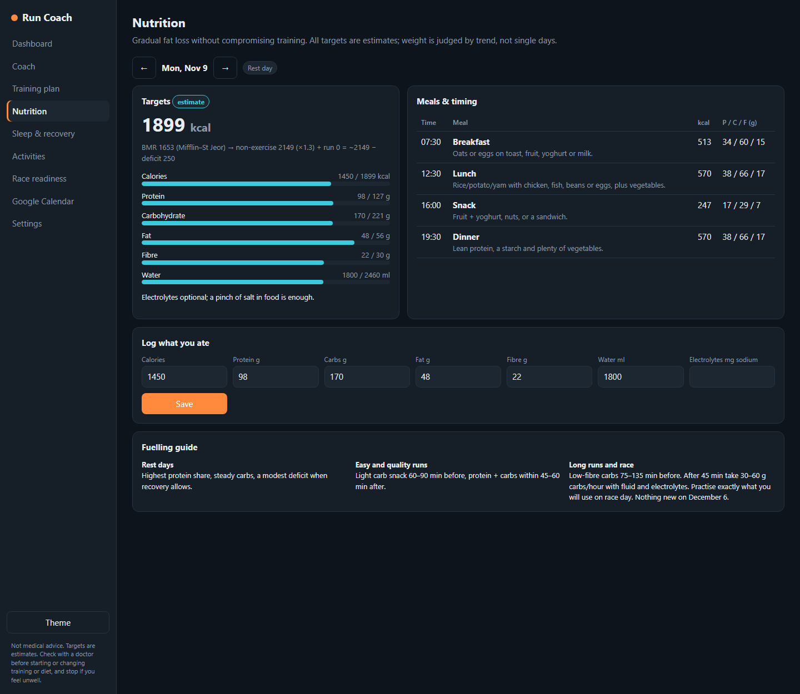
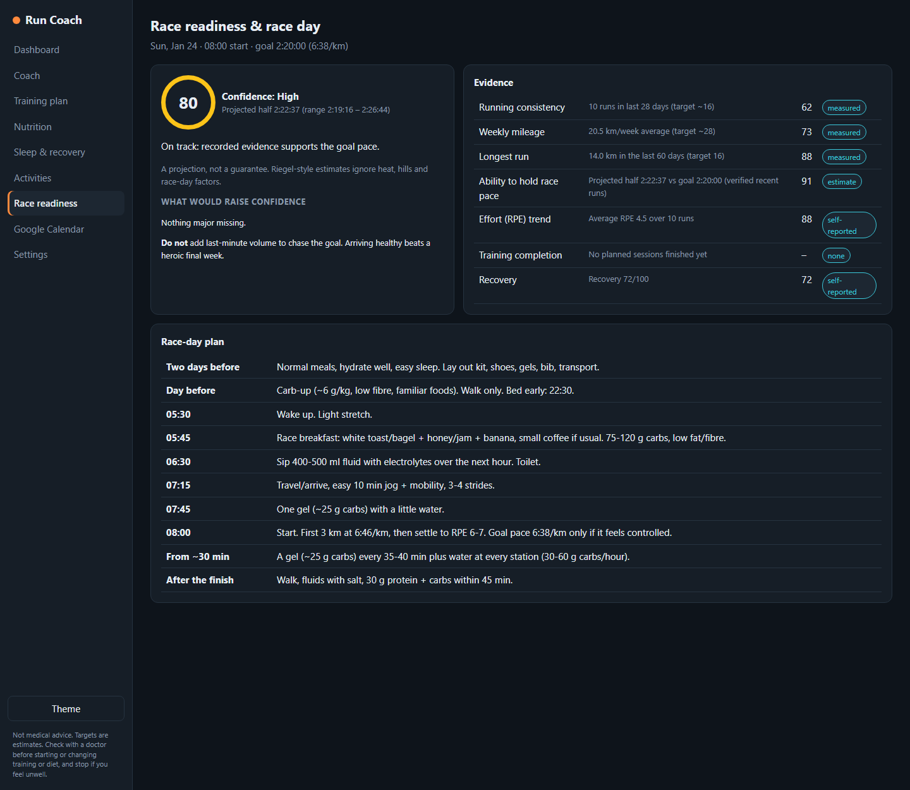
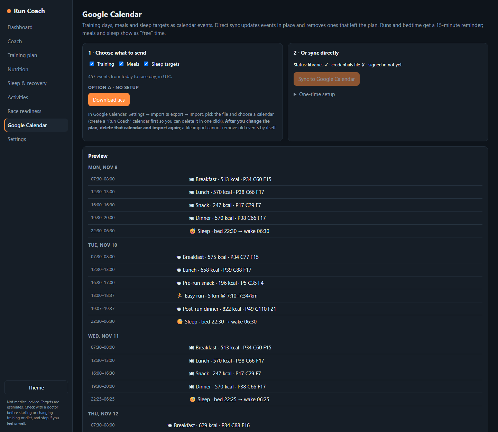

<div align="center">

# Run Coach

**A private race-training coach that runs entirely on your own computer.**
Adaptive four-day running plan · nutrition and sleep targets · race readiness · Google Calendar export · optional local AI coach.




<sub>Screenshots use made-up demo data.</sub>

</div>

> **Not medical advice.** Targets are estimates. Check with a doctor before starting or changing training or diet, and stop if you feel unwell.

## Why

Most training apps want an account, a subscription and your data. Run Coach is a single-user tool: no login, no cloud, no tracking. Your runs, weight, sleep and food logs live in one folder on your computer. The "AI" part is optional and also runs locally.

It is built around a half marathon, four running days a week (Tue, Thu, Sat, Sun), and the idea that **safe and realistic beats ambitious**: the plan rebuilds from what you have actually run, keeps Saturday easy before the Sunday long run, tapers, and never promises a finish time.

## Features

| | |
|---|---|
| **Adaptive plan** | Every run has a distance, pace, speed, duration and effort (RPE). Long runs rebuild from your last three weeks of real running (at most +2 km a week), then taper. Plan changes are *proposed* and only saved when you confirm. |
| **Fitness and paces** | Projects your half-marathon time from your longest recent efforts (Riegel formula) and derives easy, long, steady and goal paces. Uses old benchmarks until you import real runs, and says which it is using. |
| **Nutrition** | Daily calories, protein, carbs, fat, fibre and water (Mifflin-St Jeor plus activity and run cost). A modest deficit that pauses in race week or when recovery is poor. Timed meals around each run and race-morning fuelling. |
| **Sleep and recovery** | Bed and wake targets that shift toward your race start time, plus a recovery score from what you log. |
| **Race readiness** | A score with a confidence level, the evidence behind it, and what is missing. Never a guarantee. |
| **Activities** | Import Strava screenshots (optional OCR) or GPX files, or type runs in. Originals are kept, duplicates flagged, and nothing is invented (no heart-rate data). |
| **Google Calendar** | Training, meals and sleep targets as an `.ics` file, or direct sync to a "Run Coach" calendar. |
| **Local AI coach** | A small [Ollama](https://ollama.com) model that answers from your numbers and a library of notes, and can only propose plan changes. |

<table>
<tr>
<td></td>
<td></td>
</tr>
<tr>
<td></td>
<td></td>
</tr>
</table>

## Quick start

Requires Python 3.10 or newer.

```bash
git clone <this-repo-url>
cd run-coach
pip install -r requirements.txt
python app.py --open
```

The app opens at http://127.0.0.1:5000. Then open **Settings** and enter your age, weight (lb), height, race date, goal time, timezone and run times. The defaults are placeholders.

**Windows shortcut:** `run.cmd` starts the app and opens the page. To pin it to the taskbar, create a shortcut to `pythonw.exe "<path>\app.py" --open` (no console window), then right-click it and choose *Pin to taskbar*.

## Importing your runs

Open **Activities** and drop in Strava screenshots (several at once) or `.gpx` files, or add runs by hand. With [Tesseract](https://github.com/tesseract-ocr/tesseract) plus `pytesseract` and `pillow` installed, the numbers are read from screenshots automatically. Without them, files are saved and you type the values in. Either way, imported values are flagged for checking and duplicates are caught.

## Local AI coach (optional)

```bash
ollama pull qwen3:4b
ollama pull nomic-embed-text
ollama create runcoach -f coach/Modelfile
```

Then open the **Coach** tab. A 4B model runs on a modest GPU (6 GB is enough) or on CPU, slower.

The design assumes small models make mistakes, so they are never trusted with numbers or safety:

- **Numbers come from code.** Every question gets a snapshot of your current figures from `engine.py`; the model quotes it and never does arithmetic.
- **Advice comes from notes.** The most relevant entries from `knowledge/` (about 60 short notes on pacing, long runs, tapering, nutrition, fuelling, sleep, recovery and safety) are attached to each question. The notes are summaries of general sports-science guidance written for this project and not checked against the original sources, so review them before relying on them.
- **Safety is hard-coded.** Chest pain, dizziness and fainting get a fixed "stop and get medical help" message. Pain gets a "see a doctor or physiotherapist" line. Requests for a guaranteed finish time get a plain refusal. None of this depends on the model's wording.
- **It cannot change your plan.** It can only propose; you press Confirm.

`python tests/coach_evals.py` asks the coach about 40 questions covering grounding, safety, honesty and plan behaviour. Run it after changing the rules, notes or model.

## Google Calendar

- **No setup:** Calendar tab, choose training, meals and sleep, download the `.ics` and import it into Google Calendar. A file import cannot delete old events, so after a plan change delete that calendar and import again.
- **Direct sync:** enable the Calendar API in Google Cloud, create an OAuth *Desktop app* client, save the JSON as `data/google_credentials.json`, then press **Sync**. Events go into a "Run Coach" calendar; re-syncing updates them in place and removes events that left the plan. Runs and bedtime get a 15-minute reminder.

## Privacy

Everything is stored in `data/` (SQLite database, uploaded screenshots, Google token), which is git-ignored along with credentials and test logs. Nothing is sent anywhere except what you choose to do: a calendar sync talks to Google, and the AI coach talks to your own local Ollama. There is no telemetry.

## Configuration

| Variable | Default | Purpose |
|---|---|---|
| `RUNCOACH_DATA` | `./data` | Where the database and uploads live (use it to keep separate datasets) |
| `RUNCOACH_PORT` | `5000` | Port to serve on |
| `RUNCOACH_MODEL` | `runcoach` | Ollama model used by the Coach tab |
| `RUNCOACH_EMBED` | `nomic-embed-text` | Ollama embedding model for the notes |
| `OLLAMA_HOST` | `http://127.0.0.1:11434` | Where Ollama is running |

## Tests

```bash
python -m unittest discover tests     # plan and calendar rules, fast, no Ollama needed
python tests/coach_evals.py           # AI coach behaviour, slow, needs Ollama
```

The coach tests are checked against the data in *your* local database, so results depend on what you have imported. They write `tests/eval_results.md`, which is git-ignored because it contains your numbers.

## How it works

`engine.py` holds every calculation as plain functions (no database, no network), so they are easy to test. `app.py` is a small Flask API over SQLite. The UI is plain HTML, CSS and JavaScript in `static/` with no build step. `coach.py` talks to Ollama, `knowledge.py` searches the notes, and `gcal.py` writes `.ics` files and syncs to Google.

## Limitations

- Built for a **half marathon on a Sunday** with up to four runs a week. Other distances and schedules are not supported yet.
- Calorie, pace and readiness numbers are **estimates** from standard formulas (Mifflin-St Jeor, Riegel) and rules of thumb, not measurements.
- The plan templates assume roughly 4 to 12 weeks before the race. Very short runways produce a conservative plan.
- Heart-rate data is deliberately not used; effort is RPE and the talk test.
- The AI coach is a small local model. It is a helpful second opinion, not an authority.

## Contributing

Issues and pull requests are welcome. Please keep the local-first, no-account design, add or update a test for new logic, and do not commit anything from `data/`.

## License

[MIT](LICENSE). Provided as is, without warranty. See the notice above: this is not medical advice.
